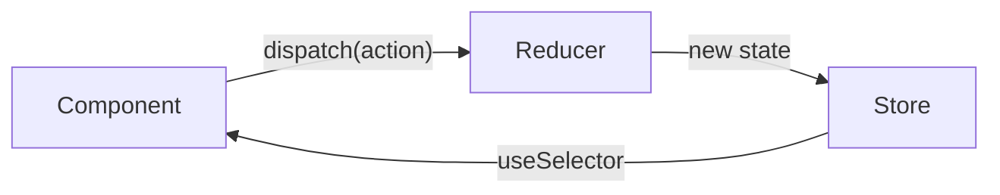

# Adding Redux to the React app

**CSIS279 · Tutorial**

The React app in `app` already works: `useFetch` loads the data each page needs, and a context holds the logged-in user. In this tutorial you move the state that *several* components share into a Redux store, starting with one small slice and ending with categories and login.

| Builds on | Packages | Covers | Time |
| --- | --- | --- | --- |
| app (React 19, GraphQL services) | Redux Toolkit 2, React Redux 9 | notifications, categories & auth | about 2 hours |

**Contents**

- [0. Why Redux?](#0-why-redux)
- [1. Install the packages](#1-install-the-packages)
- [2. Your first slice and the store](#2-your-first-slice-and-the-store)
- [3. Read and change state from React](#3-read-and-change-state-from-react)
- [4. Async: loading categories](#4-async-loading-categories)
- [5. Create, update and delete](#5-create-update-and-delete)
- [6. Selectors and derived data](#6-selectors-and-derived-data)
- [7. One action, several slices](#7-one-action-several-slices)
- [8. Move login into Redux](#8-move-login-into-redux)
- [9. Clear everything on logout](#9-clear-everything-on-logout)
- [10. What belongs in the store?](#10-what-belongs-in-the-store)
- [Exercises](#exercises)
- [Troubleshooting](#troubleshooting)

## 0. Why Redux?

Two pages in the app need the categories: `CategoriesView` lists them and `ProductFormView` puts them in a dropdown. Each calls `getCategories()` and keeps its own copy in `useState`, which React throws away when the user leaves the page. Come back, and you wait for the spinner again.

Redux keeps shared state in **one store, outside the components**. Any component can read from it, and every change goes through one path:



You already share state through context, in `AuthProvider`. Here is how they differ:

| | Context (what you have) | Redux (what you'll add) |
| --- | --- | --- |
| **What it is** | A way to pass a value down the tree | A store with rules for changing state |
| **Where changes happen** | Anywhere that calls a setter | In reducers, in response to actions |
| **What re-renders** | Every component reading the context | Only components whose selected value changed |
| **Debugging** | `console.log` | DevTools list every action and the state after it |
| **Usable outside React** | No | Yes: `store.dispatch(...)` |

> [!NOTE]
> Redux is not a requirement for React apps. If state is used by one component, keep `useState`. Redux pays off when state is shared by distant components or changed from many places. Step 10 returns to this.

### Words you'll meet

- **Store**: the object that holds the whole state.
- **Action**: a plain object saying what happened, like `{ type: "categories/delete/fulfilled", ... }`. Its data usually goes in `payload`.
- **Reducer**: a function `(state, action) => newState`. It must be *pure*: no requests, no random values, no changes to anything outside.
- **Dispatch**: sending an action to the store. It is the only way to change the state.
- **Slice**: one feature's part of the state, with its reducers and actions.
- **Selector**: a function that reads a value from the state.
- **Thunk**: a function you dispatch instead of an action, to do async work first.

Older tutorials write action constants, `switch` reducers and `{...state}` copies by hand. **Redux Toolkit** (RTK) generates all that and is the official way to write Redux today. If you see `createStore` in an example, it is using the old style.

## 1. Install the packages

From the `app` folder:

*Terminal*

```bash
npm install @reduxjs/toolkit react-redux
```

- `@reduxjs/toolkit` creates the store and slices. Redux itself comes with it.
- `react-redux` connects the store to React: `Provider`, `useSelector` and `useDispatch`.

Also install the **Redux DevTools** extension in your browser. RTK connects to it automatically.

## 2. Your first slice and the store

Start with something small and without requests: messages that pop up in the corner of the page. Any component may add one, and one component shows them, so this is shared state.

**`app/src/store/notificationsSlice.js`** (new file)

```js
import { createSlice, nanoid } from "@reduxjs/toolkit";

const initialState = [];

const notificationsSlice = createSlice({
    name: "notifications",
    initialState,
    reducers: {
        notificationAdded: {
            reducer: (state, action) => {
                state.push(action.payload);
            },
            // reducers must be pure, so the random id is made here, before the reducer runs
            prepare: (message) => ({ payload: { id: nanoid(), message } })
        },
        notificationDismissed: (state, action) => {
            return state.filter((notification) => notification.id !== action.payload);
        }
    }
});

export const { notificationAdded, notificationDismissed } = notificationsSlice.actions;

export const selectNotifications = (state) => state.notifications;

export default notificationsSlice.reducer;
```

`createSlice` does three things: it builds the reducer, writes an action creator for each case, and names the actions (`notifications/notificationAdded`).

> [!NOTE]
> **`state.push(...)` changes the state. Isn't that forbidden?** RTK runs your reducers through a library called Immer. The `state` you receive is a draft that records your changes, and Immer builds a new state from them. Inside a slice reducer, *either* change the draft *or* return a new value (as `notificationDismissed` does), not both. Outside reducers, never change the state.

Now the store. Each key you give `configureStore` becomes a key of the state:

**`app/src/store/index.js`** (new file)

```js
import { configureStore } from "@reduxjs/toolkit";
import notificationsReducer from "./notificationsSlice";

const store = configureStore({
    reducer: {
        notifications: notificationsReducer
    }
});

export default store;
```

Wrap the app in `Provider`, so every component can reach the store:

**`app/src/main.jsx`**

```jsx
import { Provider } from 'react-redux'
import store from './store';
// ...the existing imports

createRoot(document.getElementById('root')).render(
  <StrictMode>
    <Provider store={store}>
      <BrowserRouter>
        <AuthProvider>
          <App />
        </AuthProvider>
      </BrowserRouter>
    </Provider>
  </StrictMode>,
)
```

## 3. Read and change state from React

Two hooks are all you need. `useSelector` reads a value and re-renders the component when that value changes. `useDispatch` returns the function that sends actions.

**`app/src/components/Notifications.jsx`** (new file)

```jsx
import { Toast, ToastContainer } from "react-bootstrap";
import { useDispatch, useSelector } from "react-redux";
import { notificationDismissed, selectNotifications } from "../store/notificationsSlice";

const Notifications = () => {
    const notifications = useSelector(selectNotifications);
    const dispatch = useDispatch();

    return (
        <ToastContainer position="bottom-end" className="position-fixed p-3">
            {
                notifications.map(({ id, message }) => (
                    <Toast
                        key={id}
                        autohide
                        delay={4000}
                        onClose={() => dispatch(notificationDismissed(id))}
                    >
                        <Toast.Header>
                            <strong className="me-auto">CSIS279</strong>
                        </Toast.Header>
                        <Toast.Body>{message}</Toast.Body>
                    </Toast>
                ))
            }
        </ToastContainer>
    )
}

export default Notifications;
```

Show it once, in `App`:

**`app/src/App.jsx`**

```jsx
import Notifications from "./components/Notifications";
// ...
      </Container>
      <Notifications />
    </>
```

### Try it in the DevTools

Run `npm run dev`, open the app, then open the browser's DevTools and choose the **Redux** tab. Open the **Dispatcher** panel and send:

```js
{ type: "notifications/notificationAdded", payload: { id: "1", message: "Hello Redux" } }
```

A message appears, and about four seconds later a `notificationDismissed` action shows up in the list. Click each action and look at its **Action**, **State** and **Diff** tabs.

From a component you would write `dispatch(notificationAdded("Hello Redux"))`. The `prepare` function adds the id.

## 4. Async: loading categories

Reducers must be pure, so requests can't happen there. They go in a **thunk**. `createAsyncThunk` wraps an async function and dispatches actions around it:

| Action | When | What it carries |
| --- | --- | --- |
| `categories/fetchAll/pending` | before the request | `meta.requestId`, `meta.arg` |
| `categories/fetchAll/fulfilled` | it succeeded | the result, in `payload` |
| `categories/fetchAll/rejected` | it failed | the error, in `error` |

The slice responds to those actions in `extraReducers`, which is for actions the slice didn't define itself. The thunk calls your existing service, so `categoryService.js` does not change.

**`app/src/store/categoriesSlice.js`** (new file)

```js
import { createAsyncThunk, createSlice } from "@reduxjs/toolkit";
import * as categoryService from "../services/categoryService";

export const fetchCategories = createAsyncThunk(
    "categories/fetchAll",
    () => categoryService.getCategories(),
    {
        // returning false cancels the thunk: don't start a second request while one is running
        condition: (_, { getState }) => getState().categories.status !== "loading"
    }
);

const initialState = {
    items: [],
    status: "idle", // "idle" | "loading" | "succeeded" | "failed"
    error: null
};

const categoriesSlice = createSlice({
    name: "categories",
    initialState,
    reducers: {},
    extraReducers: (builder) => {
        builder
            .addCase(fetchCategories.pending, (state) => {
                state.status = "loading";
                state.error = null;
            })
            .addCase(fetchCategories.fulfilled, (state, action) => {
                state.status = "succeeded";
                state.items = action.payload;
            })
            .addCase(fetchCategories.rejected, (state, action) => {
                state.status = "failed";
                state.error = action.error.message;
            });
    }
});

export const selectCategories = (state) => state.categories.items;
export const selectCategoriesError = (state) => state.categories.error;

// only the first load shows a spinner; later ones refresh the list in the background
export const selectCategoriesLoading = ({ categories }) =>
    categories.status === "idle" ||
    (categories.status === "loading" && categories.items.length === 0);

export default categoriesSlice.reducer;
```

> [!NOTE]
> **Why `condition`?** In development, `StrictMode` runs every effect twice, so the thunk is dispatched twice. The condition stops the second one while the first is running. It also helps when two components on the same page ask for the same data.

Register the reducer:

**`app/src/store/index.js`**

```js
import categoriesReducer from "./categoriesSlice";
// ...
    reducer: {
        notifications: notificationsReducer,
        categories: categoriesReducer
    }
```

Two pages need the same three values and the same effect, so write a hook:

**`app/src/hooks/useCategories.js`** (new file)

```js
import { useEffect } from "react";
import { useDispatch, useSelector } from "react-redux";
import {
    fetchCategories,
    selectCategories,
    selectCategoriesError,
    selectCategoriesLoading
} from "../store/categoriesSlice";

// the categories from the store, refreshed when a component using them appears
const useCategories = () => {
    const dispatch = useDispatch();
    const categories = useSelector(selectCategories);
    const loading = useSelector(selectCategoriesLoading);
    const error = useSelector(selectCategoriesError);

    useEffect(() => {
        dispatch(fetchCategories());
    }, [dispatch]);

    return { categories, loading, error };
}

export default useCategories;
```

It fetches each time a page using it opens, but `selectCategoriesLoading` is true only when there is nothing to show. A returning user sees the list at once, and it refreshes in the background.

Use it in the product form. The product itself still comes from `useFetch`:

**`app/src/views/ProductFormView.jsx`**

```jsx
import useCategories from "../hooks/useCategories";
// remove the getCategories import

    // before
    const fetchData = useCallback(async () => {
        const [categories, product] = await Promise.all([ /* ... */ ]);
        return { categories, product };
    }, [id, isEdit]);
    const { data: { categories, product }, loading, error, setError } =
        useFetch(fetchData, { categories: [], product: null });

    // after
    const { categories, loading: categoriesLoading, error: categoriesError } = useCategories();

    const fetchProduct = useCallback(
        () => (isEdit ? getProductById(id) : Promise.resolve(null)),
        [id, isEdit]
    );
    const { data: product, loading: productLoading, error, setError } = useFetch(fetchProduct, null);

    const loading = categoriesLoading || productLoading;

    // in the JSX, above the existing error alert
    {categoriesError && <Alert variant="danger">{categoriesError}</Alert>}
```

Open **Products → + Add Product**, and watch `pending` then `fulfilled` in the DevTools.

## 5. Create, update and delete

Add three thunks below `fetchCategories`:

**`app/src/store/categoriesSlice.js`**

```js
export const createCategory = createAsyncThunk(
    "categories/create",
    (category) => categoryService.createCategory(category)
);

// a thunk takes one argument, so several values go in an object
export const updateCategory = createAsyncThunk(
    "categories/update",
    ({ id, category }) => categoryService.updateCategory(id, category)
);

export const deleteCategory = createAsyncThunk(
    "categories/delete",
    (id) => categoryService.deleteCategory(id)
);
```

And three cases at the end of the `builder` chain. The chain is one expression, so move its final `;` to the new last line (you will do this again in later steps). The server returns the saved category, so you can update the list without fetching it again:

**`app/src/store/categoriesSlice.js`** (inside `extraReducers`)

```js
            .addCase(createCategory.fulfilled, (state, action) => {
                state.items.push(action.payload);
            })
            .addCase(updateCategory.fulfilled, (state, action) => {
                const index = state.items.findIndex((category) => category.id === action.payload.id);
                if (index !== -1) {
                    state.items[index] = action.payload;
                }
            })
            .addCase(deleteCategory.fulfilled, (state, action) => {
                // meta.arg is what the thunk was called with: the id
                state.items = state.items.filter((category) => category.id !== action.meta.arg);
            });
```

Now the list page:

**`app/src/views/CategoriesView.jsx`**

```jsx
import { useState } from "react";
import { useDispatch } from "react-redux";
import useCategories from "../hooks/useCategories";
import { deleteCategory } from "../store/categoriesSlice";
// remove the useFetch and categoryService imports

    // replaces useFetch
    const dispatch = useDispatch();
    const { categories, loading, error: loadError } = useCategories();

    const [error, setError] = useState("");

    const { run } = useAsyncAction(setError);

    // in handleDelete, after the confirmation
    run(() => dispatch(deleteCategory(id)).unwrap());

    // in the JSX, above the existing error alert
    {loadError && <Alert variant="danger">{loadError}</Alert>}
```

> [!WARNING]
> **Don't forget `.unwrap()`.** A dispatched `createAsyncThunk` never throws, even when the request fails: it dispatches `rejected` and resolves normally. Without `.unwrap()`, `useAsyncAction` sees a success and the user never learns that the delete failed. `.unwrap()` returns the payload, or throws the error.

And the form page, where forgetting it would send the user back to the list after a failed save:

**`app/src/views/CategoryFormView.jsx`**

```jsx
import { useDispatch } from "react-redux";
import { getCategoryById } from "../services/categoryService";
import { createCategory, updateCategory } from "../store/categoriesSlice";
// ...
    const dispatch = useDispatch();
// ...
    const handleSave = (data) => run(async () => {
        if (isEdit) {
            await dispatch(updateCategory({ id, category: data })).unwrap();
        } else {
            await dispatch(createCategory(data)).unwrap();
        }

        navigate("/categories");
    });
```

Delete a category and check the **Network** tab: one request for the delete, and none to reload the list.

## 6. Selectors and derived data

Show how many categories are active. Don't store that number: it can be computed from `items`, and a stored copy can become wrong. A first try might be:

```js
// don't do this
const active = useSelector((state) => state.categories.items.filter((c) => c.isActive));
```

`filter` makes a new array on every call. `useSelector` compares with `===`, so it sees a "change" after *every* action anywhere in the app, and re-renders. In development it warns: *"Selector … returned a different result when called with the same parameters. This can lead to unnecessary rerenders."*

`createSelector` remembers the last result and recomputes only when its inputs change:

**`app/src/store/categoriesSlice.js`**

```js
import { createAsyncThunk, createSelector, createSlice } from "@reduxjs/toolkit";
// ...
// derived data: recomputed only when the items change
export const selectActiveCategories = createSelector(
    [selectCategories],
    (items) => items.filter((category) => category.isActive)
);
```

**`app/src/views/CategoriesView.jsx`**

```jsx
import { useDispatch, useSelector } from "react-redux";
import { deleteCategory, selectActiveCategories } from "../store/categoriesSlice";
// ...
    const activeCategories = useSelector(selectActiveCategories);
// ...
<Card.Header as="h2" className="h6 py-3 mb-0">Categories ({activeCategories.length} active)</Card.Header>
```

## 7. One action, several slices

The user should see a message after each save. You could dispatch `notificationAdded` in every view, but the actions you need already exist. Every slice receives every action, so let the notifications slice listen:

**`app/src/store/notificationsSlice.js`**

```js
import { createCategory, updateCategory, deleteCategory } from "./categoriesSlice";
// ...after reducers: { ... },
    // actions that belong to other slices
    extraReducers: (builder) => {
        builder
            .addCase(createCategory.fulfilled, (state, action) => {
                state.push({ id: action.meta.requestId, message: `Created "${action.payload.name}"` });
            })
            .addCase(updateCategory.fulfilled, (state, action) => {
                state.push({ id: action.meta.requestId, message: `Updated "${action.payload.name}"` });
            })
            .addCase(deleteCategory.fulfilled, (state, action) => {
                state.push({ id: action.meta.requestId, message: "Category deleted" });
            });
    }
```

No view changed. This is why actions are best named after *what happened* ("category deleted") rather than *what to do* ("show a message"): one event can matter to several slices. The thunk's `requestId` is already unique, so it serves as the message's id.

## 8. Move login into Redux

`AuthProvider` holds the user for the whole app. Moving it to the store takes one slice, and no component has to change, because they all go through `useAuth`.

**`app/src/store/authSlice.js`** (new file)

```js
import { createSlice } from "@reduxjs/toolkit";
import { getToken, setToken } from "../services/apiFetch";
import * as authService from "../services/authService";

const authSlice = createSlice({
    name: "auth",
    initialState: () => ({
        user: null,
        // only wait for the API when there is a saved token to check
        loading: Boolean(getToken())
    }),
    reducers: {
        sessionStarted: (state, action) => {
            state.user = action.payload;
            state.loading = false;
        },
        sessionEnded: (state) => {
            state.user = null;
            state.loading = false;
        }
    }
});

export const { sessionStarted, sessionEnded } = authSlice.actions;

// plain thunks: functions that receive dispatch, so they can do async work first

export const login = (email, password) => async (dispatch) => {
    const result = await authService.login(email, password);
    setToken(result.token);
    dispatch(sessionStarted(result.user));
}

export const register = (data) => async (dispatch) => {
    const result = await authService.register(data);
    setToken(result.token);
    dispatch(sessionStarted(result.user));
}

export const logout = () => (dispatch) => {
    setToken(null);
    dispatch(sessionEnded());
}

// reloads the user's roles and permissions, e.g. after editing a role they have
export const refreshUser = () => async (dispatch) => {
    dispatch(sessionStarted(await authService.getCurrentUser()));
}

// restores the session after a page refresh
export const restoreSession = () => async (dispatch) => {
    if (!getToken()) {
        return;
    }

    try {
        await dispatch(refreshUser());
    } catch {
        dispatch(sessionEnded());
    }
}

export const selectUser = (state) => state.auth.user;
export const selectAuthLoading = (state) => state.auth.loading;

export default authSlice.reducer;
```

> [!WARNING]
> **Why not `createAsyncThunk` for login?** It puts its argument in `action.meta.arg` of every action it dispatches. Calling it with `{ email, password }` would show the password in the DevTools and to any middleware that logs actions. A plain thunk dispatches only what you choose. The token stays out of the store for the same reason.

Register it as `auth: authReducer` in `store/index.js`, then rewrite `useAuth` so it returns what the context used to:

**`app/src/store/index.js`**

```js
import { configureStore } from "@reduxjs/toolkit";
import notificationsReducer from "./notificationsSlice";
import categoriesReducer from "./categoriesSlice";
import authReducer from "./authSlice";

// each key here becomes a key of the state: state.notifications, state.categories...
export const reducer = {
    notifications: notificationsReducer,
    categories: categoriesReducer,
    auth: authReducer
};

const store = configureStore({ reducer });

export default store;
```

**`app/src/context/useAuth.js`**

```js
import { useCallback, useMemo } from "react";
import { bindActionCreators } from "@reduxjs/toolkit";
import { useDispatch, useSelector } from "react-redux";
import {
    login,
    logout,
    refreshUser,
    register,
    selectAuthLoading,
    selectUser
} from "../store/authSlice";

const useAuth = () => {
    const dispatch = useDispatch();
    const user = useSelector(selectUser);
    const loading = useSelector(selectAuthLoading);

    // wraps each one in dispatch, so components can keep calling login(email, password)
    const actions = useMemo(
        () => bindActionCreators({ login, register, logout, refreshUser }, dispatch),
        [dispatch]
    );

    // only used to hide what the user can't do; the API checks every request itself
    const can = useCallback((permission) => Boolean(user?.permissions?.includes(permission)), [user]);

    return { user, loading, can, ...actions };
}

export default useAuth;
```

The two effects in `AuthProvider` ran once per app, so they become two lines in `main.jsx`. This works because the store lives outside React:

**`app/src/main.jsx`**

```jsx
import { StrictMode } from 'react'
import { createRoot } from 'react-dom/client'
import { Provider } from 'react-redux'
import { BrowserRouter } from 'react-router-dom'
import './index.css'
import App from './App.jsx';
import store from './store';
import { restoreSession, sessionEnded } from './store/authSlice';
import { SESSION_EXPIRED_EVENT } from './services/apiFetch';
import 'bootstrap/dist/css/bootstrap.min.css';

// graphqlFetch fires this when the API rejects the token
window.addEventListener(SESSION_EXPIRED_EVENT, () => store.dispatch(sessionEnded()));
store.dispatch(restoreSession());

createRoot(document.getElementById('root')).render(
  <StrictMode>
    <Provider store={store}>
      <BrowserRouter>
        <App />
      </BrowserRouter>
    </Provider>
  </StrictMode>,
)
```

Delete `context/AuthProvider.jsx` and `context/AuthContext.js`. `Can`, `ProtectedRoute`, `LoginView` and the rest work as before.

> [!NOTE]
> The old `AuthProvider` had a `console.log(result.token)` in `login`. It goes away with the file. Never log tokens: anyone who can read the console can use them.

## 9. Clear everything on logout

Log out, log in as another user, and look at the state: the first user's categories are still there. Context state had the same lifetime as its page, but the store lives until the tab is reloaded. **Every slice holding a user's data must clear it when the session ends.**

Step 7 showed how: listen for `sessionEnded`.

**`app/src/store/categoriesSlice.js`**

```js
import { sessionEnded } from "./authSlice";
// ...last in the builder chain
            // one user's data must not be there for the next one
            .addCase(sessionEnded, () => initialState);
```

**`app/src/store/notificationsSlice.js`**

```js
import { sessionEnded } from "./authSlice";
// ...last in the builder chain
            .addCase(sessionEnded, () => initialState);
```

One gap remains. If the user logs out *while* categories are loading, the answer arrives after the reset and fills the list again. Remember which request you are waiting for, and ignore the others:

**`app/src/store/categoriesSlice.js`**

```js
const initialState = {
    items: [],
    status: "idle", // "idle" | "loading" | "succeeded" | "failed"
    error: null,
    requestId: null // the request we are waiting for
};

// ...in extraReducers
            .addCase(fetchCategories.pending, (state, action) => {
                state.status = "loading";
                state.error = null;
                state.requestId = action.meta.requestId;
            })
            .addCase(fetchCategories.fulfilled, (state, action) => {
                // an answer we are no longer waiting for, e.g. the user logged out meanwhile
                if (state.requestId !== action.meta.requestId) {
                    return;
                }
                state.status = "succeeded";
                state.items = action.payload;
            })
            .addCase(fetchCategories.rejected, (state, action) => {
                if (state.requestId !== action.meta.requestId) {
                    return;
                }
                state.status = "failed";
                state.error = action.error.message;
            })
```

After a logout `requestId` is `null`, so a late answer matches nothing.

## 10. What belongs in the store?

You did not move everything, on purpose:

| State | Where | Why |
| --- | --- | --- |
| Categories, the user, notifications | Redux | Used by several distant components |
| What is typed in a form | `useForm` | One component uses it, and it dies with the form |
| The category being edited | `useFetch` | One page uses it, and it should be fresh before editing |
| The error of a failed delete | `useState` | Belongs to that page |
| The current page and its id | The URL | React Router already manages it |
| The number of active categories | A selector | Can be computed |

State should also be **serializable** (objects, arrays, strings, numbers, booleans, null). No `Date`, `Map`, promise or class instance: RTK warns about them in development.

Much of `categoriesSlice` is a cache of server data. RTK includes **RTK Query** for exactly that: you describe the endpoints and it generates the fetching, caching and loading state. Writing it by hand first shows what it does for you.

## Exercises

1. **Products.** Write `productsSlice` and `useProducts`, and use them in `ProductsView` and `OrderFormView` (its dropdown lists products). Remember to clear it on logout.
2. **Error messages.** Make the notifications slice show a message when `deleteCategory` is rejected. Add a `variant` (`"success"` or `"danger"`) to each notification and pass it to `Toast` as `bg`.
3. **Search.** Add a `search` string to the categories slice, a `searchChanged` reducer and a `selectVisibleCategories` selector with two inputs (the items and the search). Then argue whether `search` should be in Redux at all.
4. **Less fetching.** Save the time of the last successful fetch and make `condition` skip requests when the data is under a minute old. Where do you read the clock, given that reducers must be pure?
5. **Test a reducer.** Reducers are plain functions. Install Vitest and check that `deleteCategory.fulfilled(true, "requestId", 1)` removes category 1.
6. **RTK Query.** Rewrite `categoriesSlice` with `createApi` and a custom `baseQuery` that calls `graphqlFetch`. Use tags so saving a category refreshes the list. What happens to the cache on logout?

## Troubleshooting

| You see | Cause and fix |
| --- | --- |
| could not find react-redux context value; please ensure the component is wrapped in a `<Provider>` | The component is outside `Provider`. Check `main.jsx`. |
| Cannot read properties of undefined (reading 'items') | The reducer isn't registered in `store/index.js`, or its key doesn't match the selector. |
| Actions must be plain objects. Instead, the actual type was: 'undefined' | You dispatched something that returned nothing. Check that the action creator returns a value. |
| Detected an action creator with type "…" being dispatched | You wrote `dispatch(notificationAdded)`. Call it: `dispatch(notificationAdded("Hi"))`. |
| Selector … returned a different result when called with the same parameters | The selector makes a new array or object each time. Use `createSelector` (step 6). |
| A non-serializable value was detected in an action | A `Date` or similar is in the payload. Send a string or number instead. |
| Cannot add property …, object is not extensible | State was changed outside a reducer. Dispatch an action instead. |
| A save fails, but the page acts as if it worked | `.unwrap()` is missing (step 5). |
| Nothing happens and no action appears | The thunk's `condition` returned false, or you called `fetchCategories()` without `dispatch`. |
| The previous user's data appears after login | The slice doesn't handle `sessionEnded` (step 9). |

---

Every code sample here was built on a copy of the CSIS279 `app` project (Redux Toolkit 2.15, React Redux 9.3, React 19.2, Vite 8.2). The finished version passes ESLint and the Vite build, and component tests with a simulated API cover listing, creating, editing and deleting categories, failed deletes, the product form's dropdown, login and logout. The `app` folder in this repository does not include these changes: you make them as you follow along.
